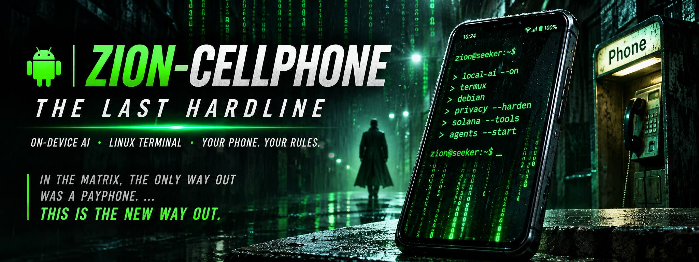

# ZION-CELLPHONE

> ## IN THE MATRIX, THE ONLY WAY OUT WAS A PAYPHONE.
>
> A ringing public telephone. A hardline. One last connection to the real world.
>
> **They took every last one.**
>
> # THIS IS THE NEW WAY OUT.
>
> **ZION-CELLPHONE. THE LAST HARDLINE.**

<p align="center">
  
</p>

**ZION-CELLPHONE** is a Solana Seeker rebuilt around a simple idea: **the most powerful thing your phone can do is belong to you.**

An AI that thinks and works **on the device**. A real Linux command-line environment. Android system controls. A stripped-down, terminal-first home screen. Privacy changes you can audit and reverse. And a hardware wallet left alone.

No cloud is required to run the local model. No AI account. No API key. No bootloader unlock.

**Your phone. Your terminal. Your AI. Your rules.**

---

## THIS IS NOT A CONCEPT

It runs on a real **Solana Seeker**, tested on **Android 16** (security patch **2026-09-05**).

| On-device result | Measured outcome |
|---|---|
| Local AI generation | **5.4 tokens/second** with the default model |
| First word from OPERATOR after the model restarts | **1.0 s** instead of 43 s (the start of the conversation is kept on disk) |
| Model memory after 10 idle minutes | **3.5 GB → 0.2 GB** (it reloads on the next question) |
| Debian 13 inside the terminal, no root | **installed in 9 s** |
| Tool-call correctness | **30/30** cases on the benchmark |
| Real screens driven by the local model alone (Settings, Bluetooth, theme, search...) | **9 of 10** requests, judged on the phone's state (first pass) |
| Reading a screen for the model | **0.3 to 0.5 s**, also on screens Android's own dump tool cannot read |
| Per-app network block, no root, no VPN | request **works, fails while cut, works again** |
| Radio decoder built on the phone, checked with no antenna | reference capture decoded as published |
| Real agent tasks | **4/4** completed in full-device validation |
| Outbound connections from the terminal app during the offline inference test | **0 observed** |
| Local model loaded in memory | **3.6 GB RAM** |
| Bootloader | **Locked** |
| Root | **Not required** |

These are results from the tested device and specific test procedures—not claims that the whole phone is invisible, anonymous, or permanently disconnected. Raw artifacts and scripts live in [`tests/`](tests/); every figure, with its date and file, is in [`docs/RESULTS.md`](docs/RESULTS.md).

## WHAT HAPPENS WHEN YOU UNPLUG?

Most AI products make your phone a remote control for someone else's computer.

**ZION-CELLPHONE puts the model on your phone.**

The default is **HauhauCS Qwen3.5-4B Uncensored Q4_K_M**, running through **llama.cpp**, compiled for the Seeker's CPU. A standard **Qwen3.5-4B Q4_0** build is available as a fallback.

Turn off Wi-Fi. Start the model. Keep working.

The project is more than a local chat interface: the agent can use tools, inspect errors, revise its own code, and carry a task through to completion—subject to explicit permissions.

### OPERATOR: AN AGENT, NOT JUST AN ANSWER BOX

**OPERATOR** is the local AI agent, launched from the terminal with `ai`. It is a project identity, not a separate cloud service.

It can:

- Write, run, debug, and fix **Python** and shell scripts.
- Create and edit permitted files, inspect output, and retry after ordinary programming errors.
- Use **git**, including creating a commit.
- Read a CSV, calculate results, and explain what it did.
- Search your permitted folders, and diagnose the phone: battery, heat, memory, storage, crashes, logs.
- Manage apps (stop, disable, enable) with a journal and an undo, never the Seed Vault.
- Work with Android services through **Shizuku**, within ADB shell-level permissions.
- Save every step: a task cut short by Android can be resumed (`/history`, `/resume`).
- Continue saved conversations and use your own system instructions.

On the phone, the full validation included **four practical programming tasks**. The narrower model comparison benchmark separately recorded **3/3** agent tasks.

**The difference:** you do not merely ask your phone how to do something. You can ask it to do the work, review the proposed action, and decide whether it may proceed.

### IT USES THE PHONE THE WAY YOU DO

Ask for something that lives behind a screen, and OPERATOR goes there: it opens the app, reads what is on the screen, taps, types, scrolls, comes back with the answer.

```text
> Désactive le Bluetooth du téléphone.
(ui:open) (ui:tap) (ui:tap)
Bluetooth est maintenant désactivé.
```

- **What it reads** is a short numbered list of what can be touched (`2 button "Bluetooth"`, `5 switch [on] "Wi-Fi"`), never a raw dump: one screen costs a few hundred characters of a 4,096-token context.
- **How it reads**: with the shell identity Shizuku provides, through a small class shipped in the launcher. No accessibility service, no extra app. Android's own `uiautomator dump` waits for a still screen and gives nothing on one that never stops moving; this reads the same tree in under half a second.
- **How it acts**: one action per step, the screen is read again just before acting and right after. A screen that changed in between is not tapped. A screen that did not change is reported as "not done". Any text can be typed, accents included.
- **What it never does**, whatever you allow: read or touch the wallet and the Seed Vault, act on a locked phone, read a window that forbids capture, answer Android's own questions (permissions, installs, VPN, USB debugging), type into a password field anything but a password your own request gives word for word.

Screen actions are **sensitive**: the terminal asks before each one (or once for the whole request; a button that deletes, resets or pays is asked again anyway). On the `ai` screen, which cannot ask, the tool exists only after you switch on `the ai may drive apps` in the launcher's `android` section, and then only in the apps you allowed yourself (`zion allow PACKAGE`). It is off by default. OPERATOR never acts inside Termux, Shizuku or the launcher: their switches decide what it may do.

### TASKS THAT SURVIVE THE PHONE

`seeker-ai --task "..."` plans the work in a few steps, runs each step as a conversation of its own, and writes its progress to disk after every tool call. Android closing Termux in the middle is not the end: `seeker-ai --task-resume` goes on from the step that was running.

A step that fails is tried once more, told why. What depends on it is not attempted; what does not, still runs. A call repeated with the same result is stopped. The final report is written by the program from what the tools actually answered (calls, outputs, files with their SHA-256), not from what the model remembers doing.

### TASKS THAT RUN WITHOUT YOU

`zion add "..."` puts a task in a queue that lives on disk. **zion**, the supervisor, runs them one at a time with nobody at the terminal, and no AI in its own code:

- **It picks up where it was.** Termux closed by Android, the phone restarted, the model server lost: the task goes on from its step. It waits for the battery, the heat, the memory and, for a task that drives the screen, for you to unlock the phone. It never unlocks it.
- **Your policy decides, not the model.** `~/.config/zion/policy.json` lists the apps OPERATOR may drive on its own (`zion allow PACKAGE`, typed by you) and, for everything else (other apps, system changes, the network, commands, secrets, payments, new rights), whether it may run, waits for you, or never runs.
- **What waits for you waits for you.** The task stops on that exact action, which you see whole. You approve it in the launcher with your fingerprint or PIN (launcher 1.8.0: the decision is signed by a key that never leaves the phone's secure hardware, checked against the key you enrolled with `zion enroll`), or by typing `zion approve` in Termux. The approval covers that one action, once.
- **A program checks the step, not the model's word.** A step can name what proves it done (an app in front, words on the screen, a file); the supervisor's limits and a step's time limit hold whatever the model says.
- **Text that gives the AI orders is data.** A screen, file or page that tries to instruct the AI is flagged to the model; after it, nothing beyond ordinary actions runs on its own, and nothing is written to memory.
- **■ STOP.** `zion-stop` (or the launcher's `■ STOP ZION`) stops every AI run at once, in plain shell, and nothing starts again until you resume it yourself (in the launcher, that resume is signed like an approval). Every event is in a hash-chained journal (`zion log`, `zion verify`).

What has and has not been run on the phone itself is in [`docs/TESTS.md`](docs/TESTS.md); the design and its limits in [`docs/AUTONOMY_SECURITY.md`](docs/AUTONOMY_SECURITY.md).

### THE PHONE IS THE WORKSTATION

The terminal environment is built around **Termux**:

```text
bash · zsh · Python 3.13 · Node.js 24
git · clang · cmake · OpenSSH
nmap · dig · tmux · ripgrep · jq
```

Code compiled on the phone runs on the phone. The terminal is not a decorative interface to a cloud service.

Need a package Termux does not have? A full **Debian 13** runs inside it through `proot-distro`, without root: installed in 9 seconds, Python and git added in under two minutes.

### ANDROID ACCESS, WITHOUT ROOT

**Shizuku** gives supported tools access through the Android shell identity (**uid 2000**), similar to ADB—not root.

Depending on the command and Android restrictions, that means access to system diagnostics, settings, package information, notifications, Wi-Fi state, screenshots, APK installation, and more. Battery, volume, and toast utilities are also available from Termux.

**This does not bypass Android's security model.** Shizuku must be started again after reboot using the documented procedure.

## THE INTERFACE: NOTHING BETWEEN YOU AND THE MACHINE

No infinite feed. No attention economy. No unnecessary decoration.

The custom launcher replaces the usual app grid with a black, monospace command-center aesthetic:

```text
ZION ZERO
─────────────────────────────────
> terminal
> ai
> applications
> android
> cyber lab
> privacy
> radio
> system
> seed-vault
─────────────────────────────────
```

Each section shows what is true now, not a brochure:

| Section | What it shows |
|---|---|
| **ai** | the conversation; long press: OPERATOR's tasks, memory, tools with their permission level, history |
| **android** | the apps, the `the ai may drive apps` switch, OPERATOR's tasks, permissions |
| **cyber lab** | terminal, dashboard (processes, connections, heat), traffic capture, what is plugged in |
| **privacy** | the apps OPERATOR cut off the network, the private DNS in use, permission managers |
| **radio** | USB accessories by what they report of themselves (`nothing plugged in` otherwise), Bluetooth, NFC, Wi-Fi |
| **system** | memory in use, battery and its temperature, heat level, free storage, the AI service's state |

The launcher is written in **Java** and built **without Gradle**. A black wallpaper option covers the home and lock screens, with the previous wallpaper backed up.

## PRIVACY IS A CONFIGURATION, NOT A SLOGAN

This is a **reversible reduction of Google and factory software**, not a replacement ROM.

The documented configuration:

- Disables **35** unused Google and factory packages in the first group.
- Disables another **23** Google applications and replaces selected functions with open-source alternatives from **F-Droid**.
- Revokes **16** permissions from Play Services.
- Uses **Private DNS** (AdGuard DNS) to block known trackers: the four tested on the phone are blocked.
- Journals changes so they can be reversed with a restore script.
- Checks Android and Seed Vault health after modifications.
- Cuts one app off every network on demand, with Android's own firewall chain: no root, and the VPN slot stays free. Tested for real: a test app's request works, fails while cut (even name resolution), works again. From the Mac (`privacy/firewall.sh`) or by asking OPERATOR. Android forgets the chain at a restart, and one command puts it back.
- Lists the names an app asks for from a capture (`privacy/pcap_domains.py`: TLS server names, HTTP hosts, DNS questions).

**Important:** Google Play Services, the services framework, and the Play Store remain for security updates and wallet-related functionality. Google may still observe activity. ZION-CELLPHONE does **not** claim to make the device untraceable.

See [`debloat/PLAN.md`](debloat/PLAN.md) for the actual trade-offs, [`docs/PRIVACY.md`](docs/PRIVACY.md) for who still talks to whom, and [`docs/ROOT.md`](docs/ROOT.md) for what works without root and what would need it.

### THE WALLET IS NOT AN EXPERIMENT

The Solana Seeker includes a **Seed Vault**. ZION-CELLPHONE does not flash a new OS, unlock the bootloader, or deliberately modify wallet components.

Before and after changes, scripts check the wallet's package baseline, signatures, secure-hardware services, and verified boot state. Additional manual checks are documented in [`tests/SEEDVAULT_MANUAL.md`](tests/SEEDVAULT_MANUAL.md).

A passing baseline check is **not** a guarantee of wallet security. Do not entrust private keys or seed phrases to the local model.

## YOU DECIDE WHAT THE AGENT MAY DO

The tool layer separates permissions into **four levels**:

| Level | Purpose |
|---|---|
| **Read** | Inspect approved data |
| **Write** | Change approved files |
| **Execute** | Run commands and code |
| **Sensitive** | Perform higher-risk operations |

Actions that execute code, reach the network, or affect the system request approval. A refusal is final for that action: the agent must not retry through a workaround.

Built-in file tools exclude hidden files such as `.ssh`, `.env`, and `.git`. Seed Vault packages are protected even from an approved request: no disabling, no network block, no screen reading, no tap.

A password you dictate for one request is used for that request and masked in the history, the status and the task reports.

**The model is not a security boundary.** Permission enforcement belongs in the surrounding code, and the repository includes tests for attempted bypasses and prompt injection.

## PROOF, NOT PROMISES

The offline comparison uses the same questions and seeds, a **4,096-token context**, and the benchmark in [`tests/bench_agent.py`](tests/bench_agent.py). Results are under [`tests/phone/`](tests/phone/).

| Measurement | HauhauCS Qwen3.5-4B Uncensored Q4_K_M **(default)** | Qwen3.5-4B Q4_0 **(fallback)** |
|---|---:|---:|
| Generation speed | **5.4 tok/s** | 5.8 tok/s |
| Start → end of repeated-question test | 5.4 → 5.6 tok/s | 5.9 → 6.0 tok/s |
| Prompt processing | 20 tok/s | 24 tok/s |
| Cold first token, 1,153-token agent prompt | 45 s | 35 s |
| Subsequent first-token latency, median | 2.6 s | 2.4 s |
| RAM peak, model read into memory as OPERATOR runs it (`--load-mode none`, `round6b.log`) | 3.6 GB | 3.5 GB |
| Correct tool calls, 15 cases × 2 seeds | **30/30** | **30/30** |
| Python unit tests, 6 functions × 2 | **12/12** | 11/12 |
| Agent benchmark tasks: script, fix, commit | **3/3** | **3/3** |
| 12-turn conversation | **12/12** | **12/12** |
| Observed outbound terminal-app connections | **0** | **0** |
| Peak CPU / skin temperature | 83.5 / 48.5 °C | 81.5 / 44.6 °C |

The default model was chosen by [`tests/bench_decide.py`](tests/bench_decide.py) using a rule defined **before** measurements were taken, rather than choosing a favorite result afterward.

A separate on-device validation with `tests/termux-round7.sh` and `tests/termux-round7b.sh` checked startup without Wi-Fi, approvals, Seed Vault protections, four programming tasks, long conversation handling, fallback selection, network silence with a positive control, dashboard behavior, and Android health.

Prompts are deliberately **in French**: this tests how the model performs in the language actually used by its owner.

Newer measurements (first-token cache, Linux, speed by thread layout, other models, battery) are in [`docs/RESULTS.md`](docs/RESULTS.md).

## USE THE PHONE

### AI ON ITS OWN SCREEN. TERMINAL IS TERMUX.

After running the Termux setup and installing launcher version **1.6.0**:

- **Tap `terminal`:** Termux, a plain shell. A new session never starts the AI by itself; type `ai` when you want OPERATOR there.
- **Tap `ai`:** a conversation screen of the launcher, not a terminal window: the phone's normal keyboard, plain-language answers. **Long press `ai`:** the technical status of `llama-server` and `dashboard`.

The `ai` screen is answered by OPERATOR itself, running in the background inside Termux (`seeker-ai --serve`, on `127.0.0.1:8095` only), with the same instructions, notes and tools as in the terminal. Anything the terminal would first ask you to approve (shell, Python, network, screenshots, disabling apps) is not offered on this screen, since it cannot ask. Steps that change something on the phone (a note kept, a file written, a notification) show as a short line, such as `(remember)`.

**Only the launcher can talk to it.** At start the service makes a key and hands it to the launcher through a broadcast that Android accepts only from Termux (`com.termux.permission.TERMUX_INTERNAL`, signature level). The key never travels again: every question is signed, every answer carries the service's own signature, and the launcher sends and shows nothing without it. If another app takes the AI's port, or the model's (`8080`, after Termux was killed), the screen says so and nothing is sent to it.

**It starts by itself:** at boot (`~/.termux/boot/zion-ai-serve`), every 15 minutes through Termux's job scheduler (job 7301, which exits at once while the service runs), and on demand: when the screen says the AI is stopped, `démarrer l'IA` opens Termux for a second (`~/.shortcuts/ai-start`) and schedules both jobs again. The first time, Termux shows its script list once: tap `ai-start`. Termux must be exempt from battery optimization to start the service in the background (Settings > Apps > Termux > Battery > Unrestricted). The Google Play build of Termux has no `RUN_COMMAND`, so the launcher needs neither that permission nor `allow-external-apps`.

`bash terminal/zion-shell-setup.sh` sets this up (`termux-setup.sh` runs it). It also takes out the line that the setup of launcher 1.5.x added to `~/.bashrc` and `~/.zshrc` (the file comes back byte for byte when nothing else changed in it). To remove the integration: `bash terminal/zion-shell-setup.sh --remove` (scripts, service and jobs go; your rc files stay as they are).

From Termux, after installation:

| Command | Action |
|---|---|
| `ai` | Launch the agent with tools |
| `ai --chat` | Talk to the model without tools |
| `ai "your task"` | Run a single task |
| `ai -f file "question"` | Ask about a file |
| `command \| ai "question"` | Pipe terminal output to the model |
| `ai --start` | Load the local model |
| `ai --stop` | Stop it and release roughly 3.5 GB RAM |
| `ai --status` | Inspect agent/model status |
| `ai --resume` | Resume the saved conversation |
| `/history`, `/resume N` | Inside OPERATOR: list the saved chats, reopen one |
| `seeker-ai --models` | Show available models |
| `seeker-ai --use NAME` | Change the default |
| `seeker-ai --model NAME` | Run with a selected model once |
| `seeker-ai --serve` | The launcher's `ai` screen service (started by Termux's job scheduler and at boot) |
| `seeker-ai --task "goal"` | Plan the goal, run it step by step with its progress on disk, end with a report |
| `seeker-ai --task-resume`, `--tasks` | Go on with an interrupted task; list the tasks and their state |
| `zion-hw` | What is plugged in or switched on now: USB accessories, Bluetooth, NFC, Wi-Fi, the radio receive chain |
| `zion add "goal"`, `zion list`, `zion status` | Queue a task for the supervisor; see the queue, the supervisor, the journal |
| `zion approve ID`, `zion deny ID` | Decide an action a task waits on (or in the launcher, with your fingerprint) |
| `zion allow PACKAGE`, `zion disallow PACKAGE` | The apps OPERATOR may drive on its own |
| `zion-stop`, `zion-stop --resume` | Emergency stop of every AI run; resume |
| `zion-guard check` | Threat check against your baseline: new apps, grants, accessibility, admins, adb, DNS, Seed Vault |
| `dash` | Open the live system dashboard |

The **dashboard** displays battery, temperature, memory, agent state, processes, per-app network connections, and sensitive permissions.

Configure tools, allowed folders, history, and other settings in:

- `~/.config/seeker-ai/config.json`
- `~/.local/share/seeker-ai/`
- `~/.config/seeker-ai/system.md` — your own instructions to the agent

## BUILD YOUR OWN EXIT

**Requirements:** a Solana Seeker, a Mac or Linux computer with `adb`, and USB debugging enabled. Tested on Android 16 with the **2026-09-05** security patch; other versions are not verified here.

**1. Identify your device.**

```bash
adb devices
export SEEKER_SERIAL=<serial-shown-by-adb>
```

**2. Audit before changing anything.** Run the read-only collector and record the Seed Vault baseline.

```bash
bash audit/collect.sh
bash tests/seedvault_check.sh baseline
```

**3. Review the changes before debloating.** Read [`debloat/PLAN.md`](debloat/PLAN.md). The documented groups are applied in sequence and stop on failed health checks.

```bash
bash debloat/apply.sh G1
bash debloat/g2lite.sh
```

**4. Install verified applications as needed.** The F-Droid fetcher checks the signed index, pinned key, APK SHA-256, and APK signer.

```bash
python3 -I apk-manager/fdroid_fetch.py <package> ...
```

**5. Install the terminal environment.** In the tested setup, Termux comes from Google Play because Play Protect blocks the F-Droid version. From the repository root on your computer:

```bash
adb push . /sdcard/Download/seeker-zero
```

Then, in Termux on the phone:

```bash
bash /sdcard/Download/seeker-zero/terminal/termux-setup.sh
```

This installs the terminal tools, agent, dashboard, and both local model files, with SHA-256 verification. It takes llama.cpp from Termux's `llama-cpp` package; the measurements here used a native build made on the phone (llama.cpp `9e9619d`, [`tests/termux-round3.sh`](tests/termux-round3.sh) then [`tests/termux-round5.sh`](tests/termux-round5.sh)), set as `llama_server` in `~/.config/seeker-ai/config.json`. If an older `llama-server` refuses an option, OPERATOR says which one.

**6. Connect Shizuku.** In the Shizuku app, use **“Use Shizuku in terminal apps” → “Export files”** into `terminal/shizuku/`, then run `terminal/seeker-setup-shizuku` in Termux. After a reboot, use `terminal/start-shizuku.sh` from the computer as documented.

**7. Install the launcher.** Build it with `launcher/build.sh`, install the generated APK, and select it as the home app. The launcher offers **system → wallpaper: black**, preserving the previous wallpaper.

**8. Restore when needed.** The project tracks reversible changes:

```bash
bash restore/restore.sh
# Or restore one group:
bash restore/restore.sh <group>
bash tests/seedvault_check.sh
```

Review the script documentation before executing it. Test the Seed Vault manually as well: [`tests/SEEDVAULT_MANUAL.md`](tests/SEEDVAULT_MANUAL.md).

## REPRODUCE THE TESTS

**On the computer:**

```bash
python3 ai/test_seeker_ai.py
python3 ai/test_zion.py
python3 -I privacy/test_zion_guard.py
python3 tests/eval_tools.py --selftest
python3 terminal/test_zion_shell.py
python3 terminal/test_seeker_dash.py
python3 terminal/zion-hw --selftest
python3 -I privacy/pcap_domains.py --selftest
python3 tests/eval_fr.py --selftest
python3 tests/eval_ui.py --selftest
python3 tests/bench_decide.py --test
bash tests/test_bench_dry.sh
bash tests/test_bench_power_dry.sh
bash tests/test_chain_dry.sh
bash tests/test_eval_tools_chain_dry.sh
bash tests/test_journal_ops.sh
```

The same suites run on every push and pull request (`.github/workflows/tests.yml`), without a phone and without a model. [`docs/TESTS.md`](docs/TESTS.md) maps them, and what ran on the phone, to twelve categories.

The supervisor's suite (`ai/test_zion.py`, **25 scenarios**) covers the queue, resuming after a crash, a lost server or a reboot, time limits, the battery, heat, memory and lock-screen waits, approvals from the terminal and signed in the launcher (checked against an openssl vector and the launcher's own Java one), the emergency stop and the journal's chain. The agent test suite covers **89 scenarios**, including the owner's policy with nobody at the terminal, parked approvals, the emergency stop, hostile text in a file, zion's own commands refused to the AI, a stream cut mid-answer, and before that approval boundaries, protected folders, quote-based bypass attempts, git reads that reach outside a repository, escape sequences hidden in tool names, a remote model server off the phone, interrupted sessions, command injection through notifications, the launcher's signed service, and since 13/11 the screen tool against canned screens (the wallet, a locked phone, a secure window, Android's permission questions, a password field, a screen that changed before the tap, a keypad), loop detection, tasks that fail, block their dependants and resume, and the per-app firewall and permission actions.

**On the phone:**

```bash
bash tests/termux-round6.sh
bash tests/termux-round7.sh
bash tests/termux-chain.sh     # unattended: speed sweep, French eval and agent bench of every model, battery test
bash tests/health.sh
bash tests/seedvault_check.sh
```

Driven from the computer, on the connected phone:

```bash
python3 tests/phone_termux.py SCRIPT          # run a script inside Termux and wait for its end
python3 tests/phone_termux.py run-eval.sh --push tests/eval_ui.py   # where run-eval.sh runs: python3 $ZION_PUSH/eval_ui.py
bash tests/firewall_real.sh                   # the per-app block, with a throwaway test app
```

`tests/eval_ui.py` gives the local model real requests ("turn Bluetooth off", "search the settings for...") and judges each one on the phone's own state afterwards (a setting, the app in front, a text on the screen), never on what the model says of itself. `tests/termux-task-check.sh` does the same for tasks, including one killed in the middle and resumed. `radio/build-rtl433.sh` builds the radio decoder in Termux and decodes a published reference capture.

The tests are provided for inspection and reproduction. They do not establish comprehensive security or general reliability on every device.

## INSIDE THE REPOSITORY

| Path | Purpose |
|---|---|
| [`ai/`](ai/) | Python agent, local model integration, installer, and tests |
| [`terminal/`](terminal/) | Termux setup, dashboard, and Shizuku utilities |
| [`launcher/`](launcher/) | Terminal-first Android launcher |
| [`debloat/`](debloat/) | Documented, health-checked reduction of unwanted packages |
| [`restore/`](restore/) | Reversal of journaled changes |
| [`apk-manager/`](apk-manager/) | Verified F-Droid APK acquisition |
| [`audit/`](audit/) | Read-only device inspection |
| [`privacy/`](privacy/) | Per-app firewall, network inspection, capture parser |
| [`radio/`](radio/) | Passive radio: decoder build and its reference check |
| [`tests/`](tests/) | Benchmarks, validation, raw results, wallet health checks |
| [`docs/`](docs/) | Measured results, privacy audit, root and no-root, other systems for the Seeker, autonomy and security, test map |
| [`adb.sh`](adb.sh) | ADB helper |

## THE IDEA

You should be able to open a terminal on your own phone, run an AI on your own hardware, inspect what it can access, deny what it cannot, and shut the whole thing off.

That does not make the device magically private. It makes the architecture **visible, local, and controllable**.

Use the security and network tools only on devices and systems you own or have permission to assess.

---

> **They removed the payphones.**
>
> **We built our own hardline.**
>
> # ZION-CELLPHONE
>
> *The last hardline. The new way out.*
